- [ggcirclepack](#ggcirclepack)
  - [Note to the reader](#note-to-the-reader)
- [status quo *without* {ggcirclepack}: precomputation required to
  create two more data
  frames](#status-quo-without-ggcirclepack-precomputation-required-to-create-two-more-data-frames)
- [Proposed UI](#proposed-ui)
- [Package functions](#package-functions)
  - [geom_circlepack_text (center)](#geom_circlepack_text-center)
    - [Step 1. compute panel](#step-1-compute-panel)
    - [Step 1.1 test compute](#step-11-test-compute)
    - [Step 2 and 3 ggproto and geom](#step-2-and-3-ggproto-and-geom)
    - [Step 4. test geom](#step-4-test-geom)
  - [geom_circlepack](#geom_circlepack)
    - [Step 1. compute_panel](#step-1-compute_panel)
    - [Step 1.1. test compute](#step-11-test-compute-1)
    - [Step 2 & 3 ggproto and geom](#step-2--3-ggproto-and-geom)
    - [Step 4. test geom](#step-4-test-geom-1)
- [Package the functions](#package-the-functions)
- [Issues](#issues)
  - [More computation under the hood for a count data
    case.](#more-computation-under-the-hood-for-a-count-data-case)

<!-- README.md is generated from README.Rmd. Please edit that file -->

# ggcirclepack

<!-- badges: start -->

<!-- badges: end -->

circle pack is an experimental package that uses the {packcircles}
package to handle circle packing computation.

### Note to the reader

Your feedback is on this work is greatly appreciated.

Beyond the descriptions of our work, we interject comments on our
hesitations 🤔 and areas that need some work 🚧, for your consideration
marked with emoji.

Your help and feedback would be greatly appreciated on any of the
questions…

- Are functions named intuitively? *‘According to IBM studies, intuitive
  variable naming contributes more to code readability than comments, or
  for that matter, any other factor’ McConnell, S. Code complete*
- Do functions work as you expect?
- Is there rewriting that could make the code more concise?
- What tests should be performed?

# status quo *without* {ggcirclepack}: precomputation required to create two more data frames

``` r
library(tidyverse)
#> ── Attaching core tidyverse packages ──────────────────────── tidyverse 2.0.0 ──
#> ✔ dplyr     1.2.0     ✔ readr     2.1.6
#> ✔ forcats   1.0.1     ✔ stringr   1.6.0
#> ✔ ggplot2   4.0.1     ✔ tibble    3.3.0
#> ✔ lubridate 1.9.4     ✔ tidyr     1.3.1
#> ✔ purrr     1.2.0     
#> ── Conflicts ────────────────────────────────────────── tidyverse_conflicts() ──
#> ✖ dplyr::filter() masks stats::filter()
#> ✖ dplyr::lag()    masks stats::lag()
#> ℹ Use the conflicted package (<http://conflicted.r-lib.org/>) to force all conflicts to become errors
gapminder::gapminder %>%  
  filter(continent == "Americas") %>%  
  filter(year == 2002) %>%  
  select(country, pop) %>% 
  mutate(id = row_number()) ->  
df_w_id

packcircles::circleProgressiveLayout(df_w_id$pop,  
                                         sizetype = 'area') ->  
x0y0radius  

x0y0radius %>%  
  packcircles::circleLayoutVertices(npoints = 50) ->  
circle_outlines  

circle_outlines %>% 
  left_join(df_w_id) %>% 
  ggplot() +  
  aes(x = x, y = y) +  
  geom_polygon(colour = "black", alpha = 0.6) +  
  aes(group = id) +  
  aes(fill = pop) +  
  geom_text(data = cbind(df_w_id, x0y0radius),  
            aes(x, y, size = pop, label = country,  
                group = NULL, fill = NULL)) +  
  theme(legend.position = "none") +  
  coord_equal()
#> Joining with `by = join_by(id)`
```

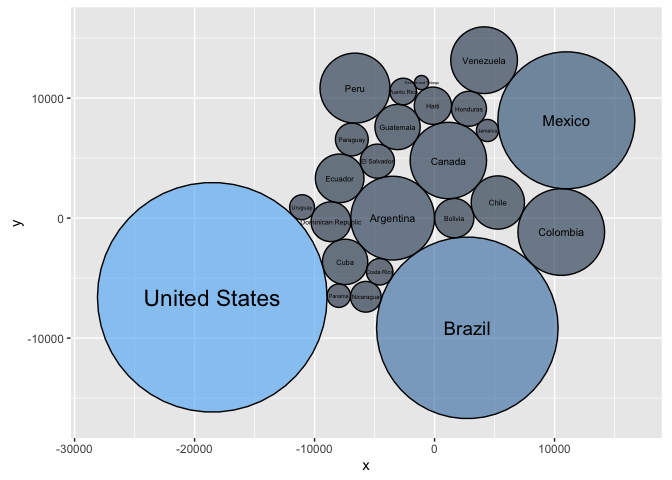

# Proposed UI

``` r
library(tidyverse)
library(ggcirclepack)

gapminder::gapminder %>%
filter(year == 2002) %>%
  ggplot() +
  aes(id = country, area = pop) +
  geom_circlepack() +               # draws packed circles 
  geom_circlepack_text() +          # labels at the center
  coord_fixed(ratio = 1)
```

# Package functions

## geom_circlepack_text (center)

### Step 1. compute panel

``` r
compute_panel_aggregation <- function(data, scales, fun = sum, non_grouping = c("area", "wt", "within")){
  
  grp_cols <-  names(data)[!names(data) %in% non_grouping]
  
  # Thanks June! https://github.com/teunbrand/ggplot-extension-club/discussions/15
  data %>% 
    group_by(group_by(pick(any_of(grp_cols)))) ->   
  data
  
  if(is.null(data$area)){data <- mutate(data, area = 1)}
  if(is.null(data$wt)){data$wt <- 1}
  
  data %>% 
    summarize(area = fun(.data$area*.data$wt), .groups = 'drop') ->
  data
    
  if(is.null(data$within)){data$within <- 1}

  data %>%   
    group_by(.data$within) %>% 
    mutate(prop = .data$area/sum(.data$area)) %>%
    mutate(percent = round(.data$prop*100)) -> 
  data
  
  data
  
}

#' compute_panel_circlepack_center
#'
#' @return
#' @export
#'
#' @examples
compute_panel_circlepack_center <- function(data, scales, fun = sum){

  # get aes names as they appear in the data
  
 data <- data |> compute_panel_aggregation(fun = fun) 
  
  
  data %>%   
    arrange(id)  -> # this doesn't feel very principled; motivation is when you go from no fill to color, preserves circle position...
  data  
  
  data %>%
    pull(area) %>%
    packcircles::circleProgressiveLayout(
      sizetype = 'area') %>%
    cbind(data) ->
  data
  
  
  if(!is.null(data$render)){
    
    data %>% 
      filter(.data$render) ->
    data
    
  }
  
  data
}
```

### Step 1.1 test compute

``` r
gapminder::gapminder %>%
filter(continent == "Americas") %>%
  filter(year == 2002) %>%
  # input must have required aesthetic inputs as columns
  select(area = pop, id = country) %>%
  compute_panel_circlepack_center() %>%
  head()
#>           x         y   radius        id      area within        prop percent
#> 1 -3493.018     0.000 3493.018 Argentina  38331121      1 0.045107495       5
#> 2  1639.564     0.000 1639.564   Bolivia   8445134      1 0.009938109       1
#> 3  2732.774 -9142.026 7567.594    Brazil 179914212      1 0.211720380      21
#> 4  1150.752  4801.407 3186.661    Canada  31902268      1 0.037542116       4
#> 5  5273.817  1302.381 2221.005     Chile  15497046      1 0.018236694       2
#> 6 10562.330 -1160.651 3612.938  Colombia  41008227      1 0.048257874       5

gapminder::gapminder %>% 
  filter(year == 2002) %>% 
  select(id = continent) %>% 
  compute_panel_circlepack_center()
#>            x         y    radius       id area within       prop percent
#> 1 -4.0684289  0.000000 4.0684289   Africa   52      1 0.36619718      37
#> 2  2.8209479  0.000000 2.8209479 Americas   25      1 0.17605634      18
#> 3  0.5868621 -5.635277 3.2410224     Asia   33      1 0.23239437      23
#> 4  0.5595510  5.461472 3.0901936   Europe   30      1 0.21126761      21
#> 5  3.8910939  3.456984 0.7978846  Oceania    2      1 0.01408451       1

gapminder::gapminder %>% 
  filter(year == 2002) %>% 
  mutate( render = country == "Argentina") %>% 
  select(id = continent, render) %>% 
  compute_panel_circlepack_center()
#>           x         y    radius       id render area within        prop percent
#> 1 0.1077182 -2.005231 0.5641896 Americas   TRUE    1      1 0.007042254       1

gapminder::gapminder %>% 
  # filter(year == 2002) %>% 
  mutate( render = country == "Argentina") %>% 
  select(id = continent, render, area = pop) %>% 
  compute_panel_circlepack_center(fun = mean)
#>           x         y   radius       id render     area within      prop
#> 1 -666.0431 -4663.549 3017.346 Americas   TRUE 28602240      1 0.1723697
#>   percent
#> 1      17
```

### Step 2 and 3 ggproto and geom

``` r
StatCirclepackcenter <- ggplot2::ggproto(`_class` = "StatCirclepackcenter",
                                  `_inherit` = ggplot2::Stat,
                                  required_aes = c("id"),
                                  compute_panel = compute_panel_circlepack_center,
                                  default_aes = ggplot2::aes(group = after_stat(id),
                                                             size = after_stat(area),
                                                             label = after_stat(id))
                                  )


#' Title
#'
#' @param mapping
#' @param data
#' @param position
#' @param na.rm
#' @param show.legend
#' @param inherit.aes
#' @param ...
#'
#' @return
#' @export
#'
#' @examples
stat_circlepack_center <- ggplot2::make_constructor(StatCirclepackcenter, geom = ggplot2::GeomText)


#' Title
#'
#' @param mapping
#' @param data
#' @param position
#' @param na.rm
#' @param show.legend
#' @param inherit.aes
#' @param ...
#'
#' @return
#' @export
#'
#' @examples
geom_circlepack_text <- ggplot2::make_constructor(ggplot2::GeomText, stat = StatCirclepackcenter)
```

### Step 4. test geom

``` r
gapminder::gapminder %>%
filter(year == 2002) %>%
  ggplot() +
  aes(id = country, area = pop) +
  geom_circlepack_text(alpha = .5) + 
  coord_equal() + 
  labs(title = "gapminder 2002 countries")
```

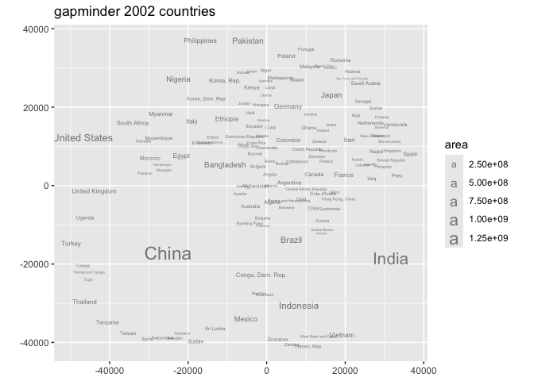

``` r

last_plot() + 
  aes(render = pop > 20000000)
```

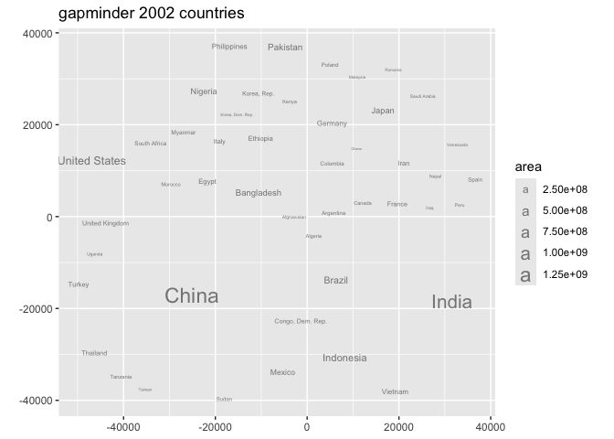

``` r


layer_data() |> 
  head()
#>            x           y   radius render          id PANEL       group
#> 1  -2836.051      0.0000 2836.051   TRUE Afghanistan     1 Afghanistan
#> 2   1442.390  -4194.8885 3155.789   TRUE     Algeria     1     Algeria
#> 3   5786.203    838.7913 3493.018   TRUE   Argentina     1   Argentina
#> 4 -10562.150   5366.9438 6571.217   TRUE  Bangladesh     1  Bangladesh
#> 5   6304.785 -13752.5065 7567.594   TRUE      Brazil     1      Brazil
#> 6  12117.233   2968.6196 3186.661   TRUE      Canada     1      Canada
#>        area within        prop percent     size       label colour family angle
#> 1  25268405      1 0.004292254       0 1.305966 Afghanistan  black            0
#> 2  31287142      1 0.005314636       1 1.461572     Algeria  black            0
#> 3  38331121      1 0.006511172       1 1.593993   Argentina  black            0
#> 4 135656790      1 0.023043538       2 2.511332  Bangladesh  black            0
#> 5 179914212      1 0.030561389       3 2.778300      Brazil  black            0
#> 6  31902268      1 0.005419125       1 1.474611      Canada  black            0
#>   hjust vjust alpha fontface lineheight
#> 1   0.5   0.5   0.5        1        1.2
#> 2   0.5   0.5   0.5        1        1.2
#> 3   0.5   0.5   0.5        1        1.2
#> 4   0.5   0.5   0.5        1        1.2
#> 5   0.5   0.5   0.5        1        1.2
#> 6   0.5   0.5   0.5        1        1.2
```

## geom_circlepack

### Step 1. compute_panel

``` r
# Step 1
#' compute_panel_circlepack
#'
#' @param data
#' @param scales
#'
#' @return
#' @export
#'
#' @examples
compute_panel_circlepack <- function(data, scales, npoints = 50, fun = sum){

  data <- data |> compute_panel_aggregation(scales, fun)

  data %>%   
    arrange(id)  -> # this doesn't feel very principled; motivation is when you go from no fill to color, preserves circle position...
  data
  
  data$id = 1:nrow(data)

  data %>%
    pull(area) %>%
    packcircles::circleProgressiveLayout(
      sizetype = 'area') %>%
    packcircles::circleLayoutVertices(npoints = npoints) %>%
    left_join(data, by = join_by(id)) 

}
```

### Step 1.1. test compute

``` r
gapminder::gapminder %>%
filter(continent == "Americas") %>%
  filter(year == 2002) %>%
  # input must have required aesthetic inputs as columns
  rename(id = country, area = pop) %>%
  compute_panel_circlepack() %>%
  head()
#>            x         y id continent year lifeExp gdpPercap     area within
#> 1    0.00000    0.0000  1  Americas 2002   74.34  8797.641 38331121      1
#> 2  -27.54349  437.7912  1  Americas 2002   74.34  8797.641 38331121      1
#> 3 -109.73958  868.6783  1  Americas 2002   74.34  8797.641 38331121      1
#> 4 -245.29200 1285.8657  1  Americas 2002   74.34  8797.641 38331121      1
#> 5 -432.06299 1682.7743  1  Americas 2002   74.34  8797.641 38331121      1
#> 6 -667.10708 2053.1445  1  Americas 2002   74.34  8797.641 38331121      1
#>        prop percent
#> 1 0.0451075       5
#> 2 0.0451075       5
#> 3 0.0451075       5
#> 4 0.0451075       5
#> 5 0.0451075       5
#> 6 0.0451075       5
```

### Step 2 & 3 ggproto and geom

``` r
StatCirclepack <- ggplot2::ggproto(`_class` = "StatCirclepack",
                                  `_inherit` = ggplot2::Stat,
                                  required_aes = c("id"),
                                  compute_panel = compute_panel_circlepack,
                                  default_aes = ggplot2::aes(group = after_stat(id))
                                  )

GeomPolygonPale <- ggplot2::ggproto(`_class` = "GeomPolygonPale",
                           `_inherit` = ggplot2::GeomPolygon,
                           default_aes = modifyList(
                             ggplot2::GeomPolygon$default_aes,
                             ggplot2::aes(fill = from_theme(
                               fill %||% scales::col_mix(ink, paper, 0.8)))))

#' Title
#'
#' @param mapping
#' @param data
#' @param position
#' @param na.rm
#' @param show.legend
#' @param inherit.aes
#' @param ...
#'
#' @return
#' @export
#'
#' @examples
stat_circlepack <- ggplot2::make_constructor(StatCirclepack, geom = GeomPolygonPale)


#' Title
#'
#' @param mapping
#' @param data
#' @param position
#' @param na.rm
#' @param show.legend
#' @param inherit.aes
#' @param ...
#'
#' @return
#' @export
#'
#' @examples
geom_circlepack <- ggplot2::make_constructor(GeomPolygonPale, stat = StatCirclepack)
```

### Step 4. test geom

``` r
gapminder::gapminder %>%
filter(year == 2002) %>%
  ggplot() +
  aes(id = country) +
  geom_circlepack(alpha = .5) + 
  geom_circlepack_text() +
  coord_equal() + 
  labs(title = "gapminder 2002 countries")
```

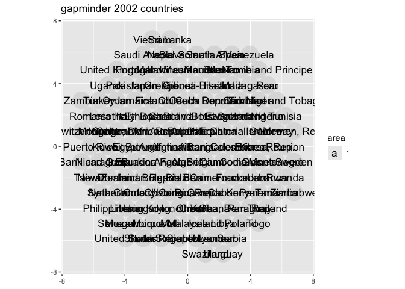

``` r

last_plot() +
  aes(fill = continent) + 
  labs(title = "from 5 continents")
```

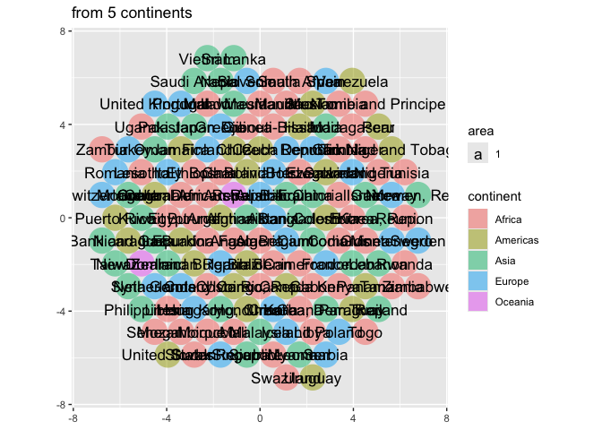

``` r

last_plot() +
  aes(area = pop) + 
  labs(title = "with very different populations")
```

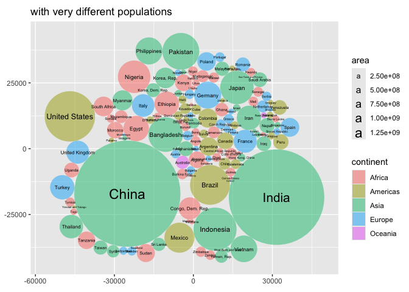

``` r

last_plot() +
  facet_wrap(facets = vars(continent)) + 
  labs(title = "faceting")
```

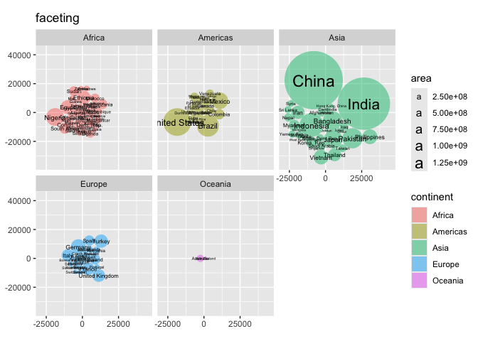

``` r

last_plot() + 
  scale_size_continuous(range = c(0, 4)) + 
  theme(legend.position = "none") + 
  labs(title = "remove legends")
```

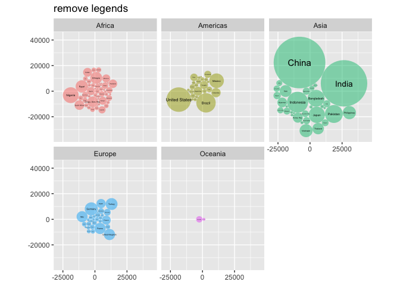

``` r

last_plot() + 
  aes(area = gdpPercap*pop) + 
  labs(title = "and very different GDPs")
```

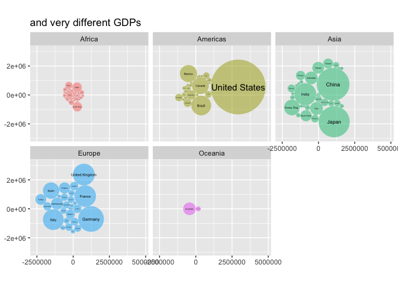

``` r

last_plot() + 
  aes(area = gdpPercap) + 
  labs(title = "and per capita GDPs 2002")
```

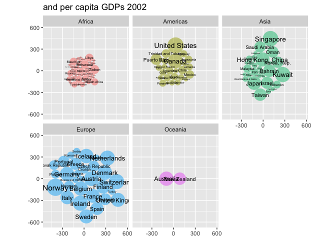

``` r

last_plot() + 
  aes(slice = continent == "Europe") + 
  facet_null() + 
  aes(fill = after_stat(area)) + 
  aes(label = paste0(country, "\n$", round(gdpPercap)))
```

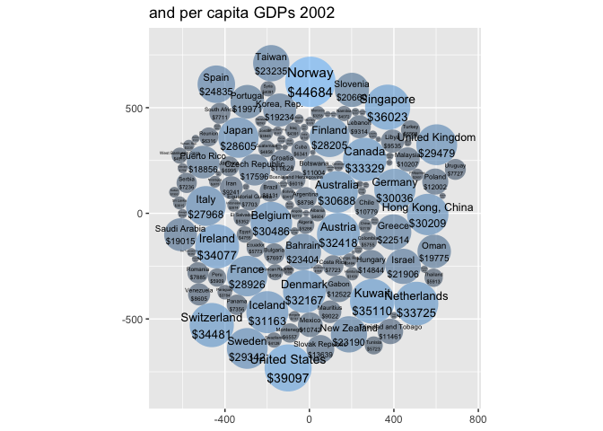

``` r


gapminder::gapminder %>%
filter(year == 2002, 
       continent == "Europe") %>%
  ggplot() +
  aes(id = country, area = pop*gdpPercap) +
  geom_circlepack() + 
  geom_circlepack_text(vjust = 0, color = "grey75",
                       lineheight = .7) +
  aes(label = str_wrap(country, 10)) +
  coord_equal() + 
  scale_size(range = c(.5,4.5)) +
  aes(slice = continent == "Europe") +
  labs(title = "Percent of European Economy 2002") + 
  aes(fill = after_stat(area)) + 
  geom_circlepack_text(vjust = 1.2, color = "grey65",
                       aes(label = paste(after_stat(percent),
                                         "percent"), 
                           size = stage(after_stat = area,
                                        after_scale = size*.85))) +
  theme(legend.position = "none")
```

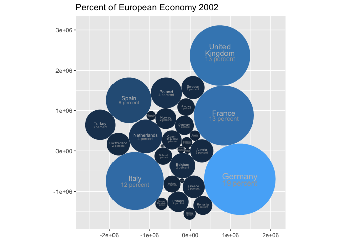

``` r
  
pride_index <- readr::read_csv('https://raw.githubusercontent.com/rfordatascience/tidytuesday/master/data/2024/2024-06-11/pride_index.csv')
#> Rows: 238 Columns: 5
#> ── Column specification ────────────────────────────────────────────────────────
#> Delimiter: ","
#> chr (3): campus_name, campus_location, community_type
#> dbl (2): rating, students
#> 
#> ℹ Use `spec()` to retrieve the full column specification for this data.
#> ℹ Specify the column types or set `show_col_types = FALSE` to quiet this message.

comm_types <- c("large urban city",
                "medium city",
                "small city",
                "small town",
                "very small town",
                "rural community")

pride_it <- pride_index %>% 
  # fix a typo
  mutate(campus_location = str_replace(campus_location, "Swarrthmore", "Swarthmore")) %>% 
  mutate(community_type = fct_relevel(community_type, comm_types)) %>% 
  mutate(state = str_sub(campus_location, -2, -1)) %>% 
  mutate(campus_name = str_replace(campus_name, "University", "U"))

ggplot(pride_it) +
  aes(id = campus_name) + 
  aes(area = students) + 
  aes(fill = rating == 5) +
  geom_circlepack(linewidth = 0.2, color = "grey99") +
  aes(label = str_wrap(after_stat(id), 10)) +
  stat_circlepack_center(geom = GeomText, 
                         lineheight = .8) +
  scale_size(range = c(0,2)) +
  aes(size = students*as.numeric(rating == 5)) + # freshly working
  facet_wrap(facets = vars(community_type))
```

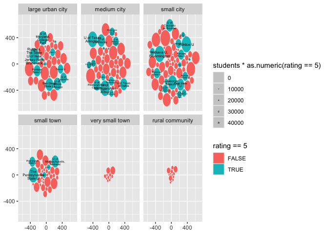

``` r
gapminder::gapminder %>%
filter(year == 2002) %>%
  ggplot() +
  aes(id = country) +
  geom_circlepack(alpha = .5) + 
  coord_equal() +
  aes(area = pop) + 
  geom_circlepack_text(aes(label = after_stat(
    paste(id, "\n",
    round(area/1000000, 1), "mil."))), lineheight = .8)
```

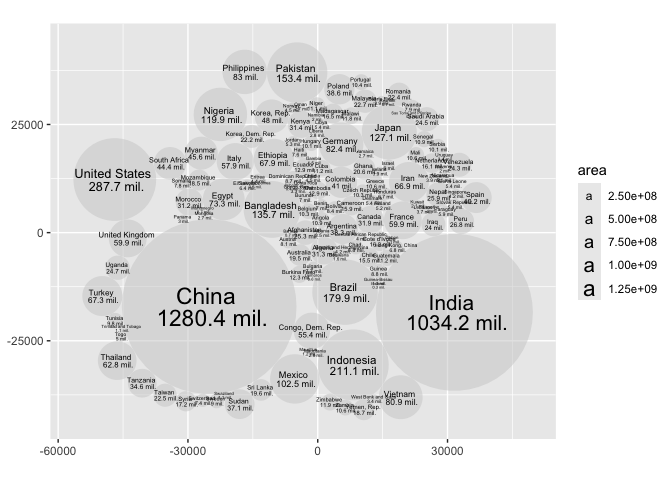

``` r

gapminder::gapminder %>%
filter(year == 2002) %>%
  ggplot() +
  aes(id = continent) + 
  geom_circlepack() +
  geom_circlepack_text(alpha = .5) + 
  coord_equal() +
  aes(fill = continent)
```

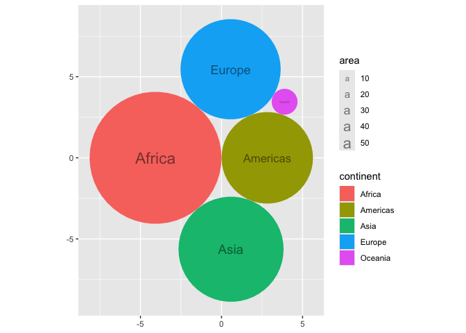

``` r

last_plot() + 
  aes(id = country)
```

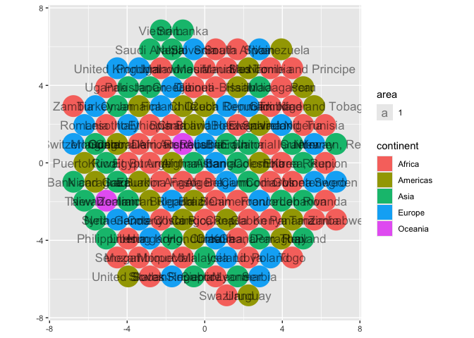

``` r

last_plot() + 
  aes(area = pop)
```

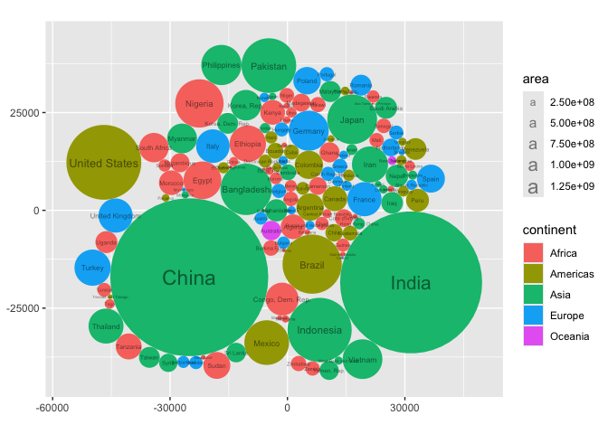

``` r
 

last_plot() + 
  facet_wrap(~continent)
```

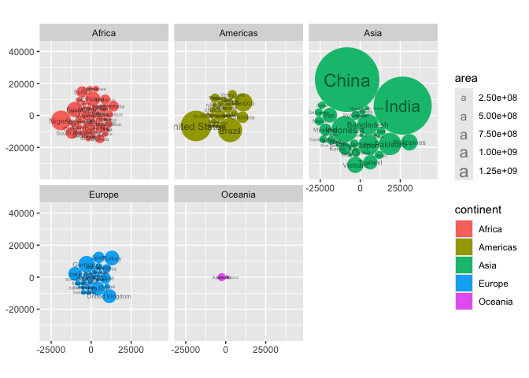

``` r


gapminder::gapminder %>%
filter(year == 2002) %>%
  ggplot() +
  aes(id = country) + 
  geom_circlepack() +
  geom_circlepack_text(alpha = .5) +
  aes(area = pop) + 
  coord_equal() + 
  aes(fill = continent) + 
  aes(render = pop > 20000000)
```


``` r

prop_by <- function(...) {
  area <- evalq(area, parent.frame())
  if (length(list(...)) == 0) {
    area / sum(area)
  } else {
    area / ave(area, ..., FUN = function(x) sum(abs(x)))
  }
}

last_plot() +
    aes(label = after_stat(scales::percent(prop_by("All"), 2)))
```


``` r

last_plot() +
    aes(label = after_stat(scales::percent(prop_by(fill), 2)))
```

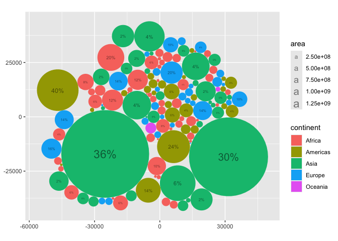

``` r


# GeomTextRepel
gapminder::gapminder %>%
filter(year == 2002) %>%
  ggplot() +
  aes(id = country) + 
  geom_circlepack() +
  layer(geom = ggrepel::GeomTextRepel, 
        stat = StatCirclepackcenter, 
        position = "identity") +
  aes(area = pop) + 
  coord_equal() + 
  aes(fill = continent) + 
  aes(render = pop > 20000000)
```

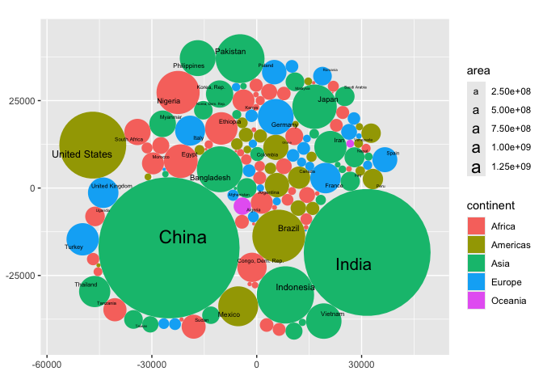

``` r
gapminder::gapminder %>%
  ggplot() + 
  aes(id = country, area = pop) + 
  geom_circlepack(fun = mean) + 
  geom_circlepack_text(fun = mean) + 
  aes(label = paste(after_stat(id), "\n",
                    round(after_stat(area)/ 1000000), "million")) +
  labs(title = "Average Population - Millions from 1952-2012") + 
  aes(fill = I("plum2")) + 
  coord_equal()
```

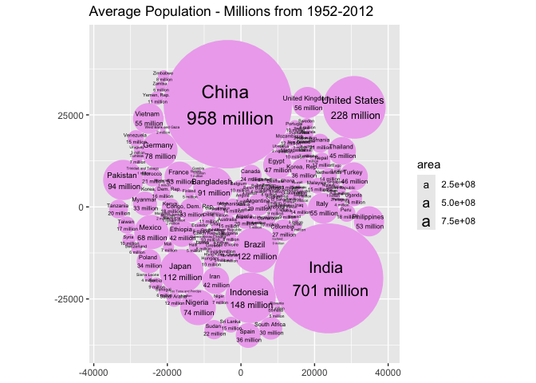

``` r
mpg %>% 
  ggplot() + 
  aes(id = cyl, area = hwy) +
  geom_circlepack(fun = mean) + 
  geom_circlepack_text(fun = mean, lineheight = .8) + 
  scale_size(range = c(4,5)) + 
  labs(title = "Average highway MPG by number of cyl") + 
  coord_equal() + 
  aes(label = 
        after_stat(paste0(id,"cyl\n", 
                          round(area), "mpg"))) + 
  aes(fill = after_stat(area)) + 
  scale_fill_viridis_c(begin = .3, end = .7) 
```

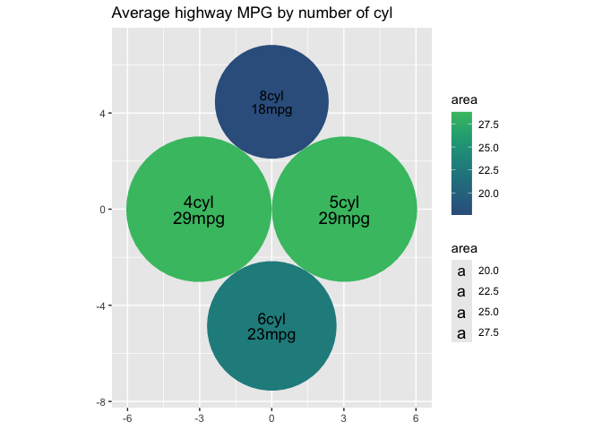

# Package the functions

``` r
knitrExtra:::chunk_to_r(chunk_name = "compute_panel_circlepack")
#> It seems you are currently knitting a Rmd/Qmd file. The parsing of the file will be done in a new R session.
knitrExtra:::chunk_to_r(chunk_name = "geom_circlepack")
#> It seems you are currently knitting a Rmd/Qmd file. The parsing of the file will be done in a new R session.
knitrExtra:::chunk_to_r(chunk_name = "compute_panel_circlepack_center")
#> It seems you are currently knitting a Rmd/Qmd file. The parsing of the file will be done in a new R session.
knitrExtra:::chunk_to_r(chunk_name = "geom_circlepack_text")
#> It seems you are currently knitting a Rmd/Qmd file. The parsing of the file will be done in a new R session.
```

``` r
devtools::document()
devtools::check()
devtools::install(pkg = ".", upgrade = "never") 
```

# Issues

Wish list for ggcirclepack:

## More computation under the hood for a count data case.

``` r
tidytitanic::tidy_titanic %>% 
  head()
```

``` r
tidytitanic::tidy_titanic %>% 
  ggplot() + 
  aes(id = "all") + 
  geom_circlepack() +
  geom_circlepack_text(aes(label = after_stat(area)), color = "gray50") +
  coord_equal() + 
  labs(title = "Titanic Passengers")
```

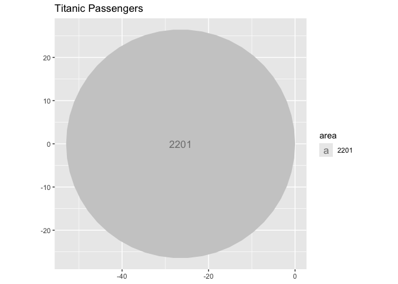

``` r

layer_data(i = 2)
#>           x y   radius  id PANEL group area within prop percent label     size
#> 1 -26.46885 0 26.46885 all     1   all 2201      1    1     100  2201 4.535534
#>   colour family angle hjust vjust alpha fontface lineheight
#> 1 gray50            0   0.5   0.5    NA        1        1.2

last_plot() +
  aes(fill = sex) +
  scale_size(range = c(3, 6))
```

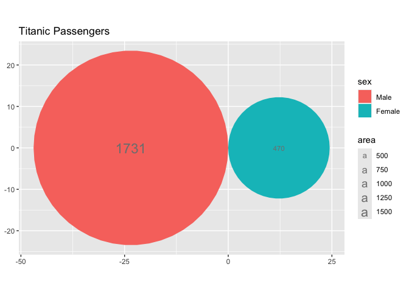

``` r

last_plot() + 
  aes(alpha = survived) +
  scale_alpha_discrete(range = c(.6,.9))
```

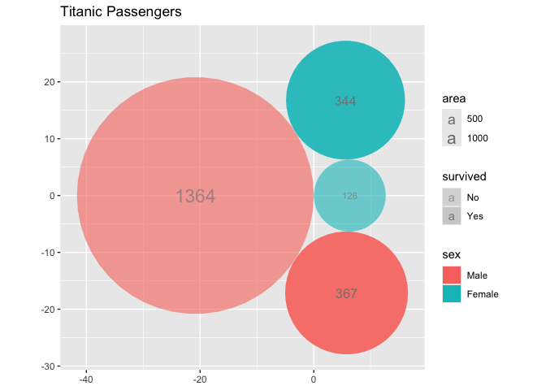

``` r

last_plot() + 
  facet_wrap(~class)
```

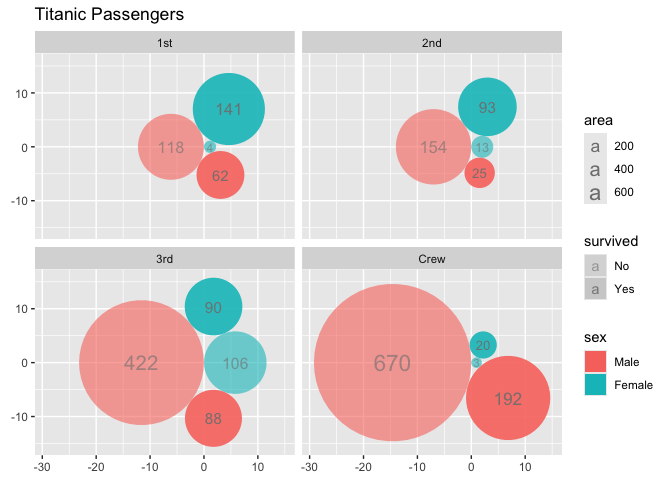

``` r

last_plot() + 
  facet_grid(age ~ class)
```

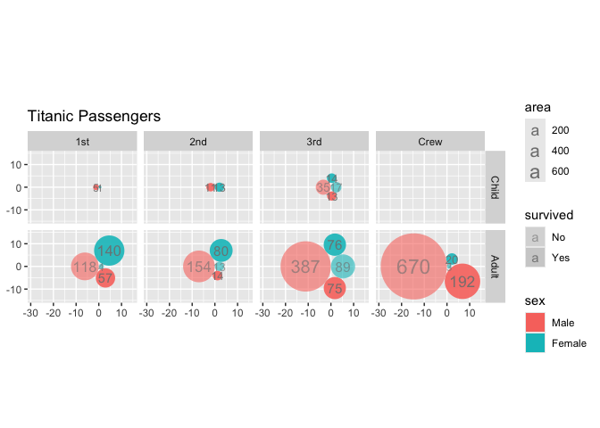

``` r
library(tidyverse)
library(ggcirclepack)
#> 
#> Attaching package: 'ggcirclepack'
#> The following objects are masked _by_ '.GlobalEnv':
#> 
#>     compute_panel_circlepack, compute_panel_circlepack_center,
#>     geom_circlepack, geom_circlepack_text, stat_circlepack,
#>     stat_circlepack_center
penguins |> 
  mutate(id = row_number()) |>
  remove_missing() |>
  ggplot() + 
  aes(area = bill_len, id = id) + 
  geom_circlepack() + 
  facet_wrap(~species)
```

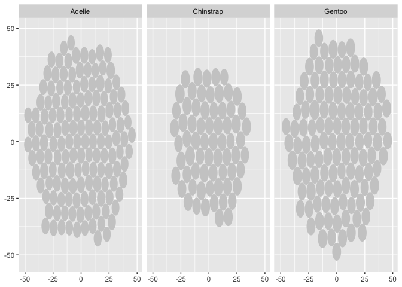
